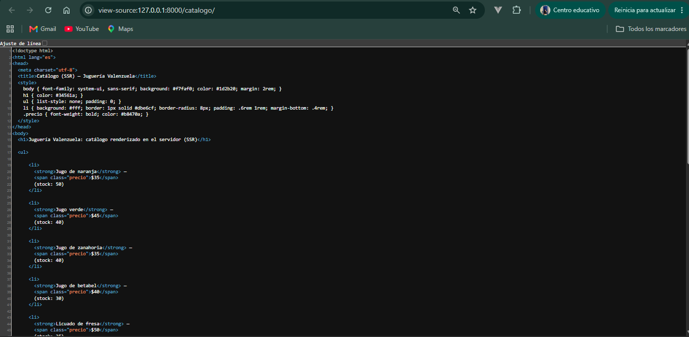
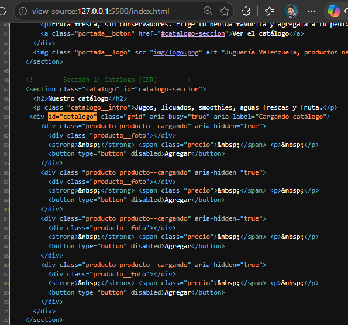
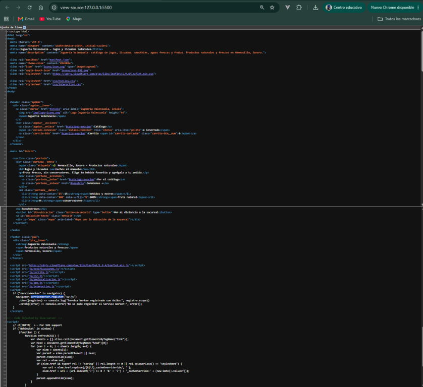
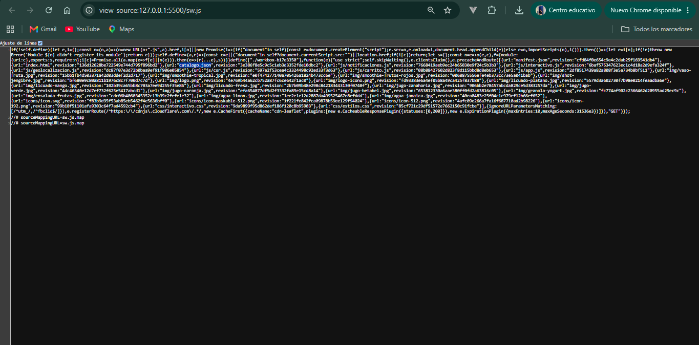

# Juguería Valenzuela — PWA de ventas

PWA de ventas de la Unidad 2 (Aplicaciones Web Progresivas): catálogo de jugos, licuados y smoothies cargado con fetch() desde catalogo.json, carrito con localStorage, funcionamiento sin conexión, notificaciones y ruta hasta la sucursal.

## Identificación
- Alumno: VALENZUELA RENDON ERUBIEL ESTEBAN
- Grupo: ING10-1
- Negocio: Juguería Valenzuela
- Giro: Juguería
- URL del repositorio: https://github.com/ValenzuelaRendonErubielEsteban/jugueria-valenzuela-pwa_valenzuela-rendon-erubiel-esteban
- URL de GitHub Pages: https://valenzuelarendonerubielesteban.github.io/jugueria-valenzuela-pwa_valenzuela-rendon-erubiel-esteban/

## Historial de avances
| Avance | Hash del commit entregado | Fecha |
|---|---|---|
| 1 | be5e7c1 | 11/10/2026 |
| 2 | d66d2b7 | 16/10/2026 |
| 3 | | 25/10/2026 |
| 4 | | |

## Comparación SSR vs CSR

### SSR (Django): los productos llegan escritos en el HTML

### CSR (JavaScript): el div del catálogo llega vacío

## Funciones PWA (avance 3)

### index.html: manifest y registro del Service Worker activos

### sw.js: Workbox precachea el catálogo y las fotos

## Cómo probarla
1. Abre la carpeta en VS Code y usa **Open with Live Server** sobre `index.html`.
2. En DevTools → Application → Service Workers debe aparecer `sw.js` como *activated and is running*.
3. Marca **Offline** y recarga: el catálogo y las fotos siguen apareciendo.
4. Instálala desde el ícono de instalar de la barra de direcciones (computadora) o desde el menú ⋮ → *Instalar aplicación* (Android).

## Qué incluye
- Catálogo con filtro por categoría y producto estrella.
- Carrito con cantidades, total y fotos, guardado en `localStorage`; se sincroniza al volver la conexión.
- Notificaciones del navegador (botón que pide permiso).
- Ubicación del cliente con ruta por calles hasta la sucursal (Leaflet + OSRM).
- Service Worker generado con Workbox y `manifest.json` con íconos de 192 y 512 px.